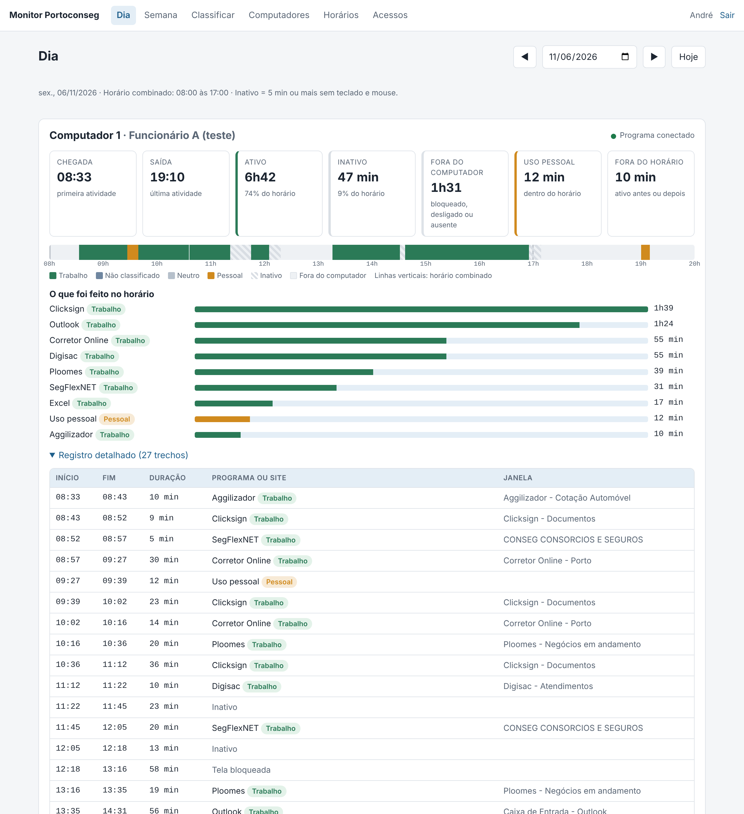
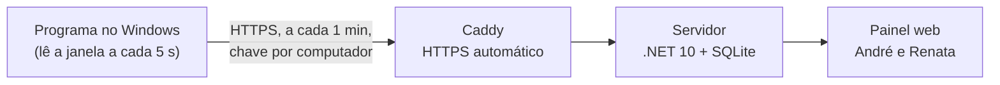

# Monitor Portoconseg

Sistema próprio para acompanhar o uso dos computadores da corretora: horários de atividade e inatividade e quais programas e sites estão em uso no expediente. Sem mensalidade: roda no VPS da empresa.

- **Guia de instalação:** [docs/instalacao.md](docs/instalacao.md)
- **Plano do sistema e decisões:** [docs/plano-monitor.md](docs/plano-monitor.md)
- **Histórico de versões:** [HISTORICO-DE-VERSOES.md](HISTORICO-DE-VERSOES.md) — versão atual no arquivo `VERSION`
- **Comparativo comprar x construir:** [docs/comparativo-ferramentas.md](docs/comparativo-ferramentas.md)



## Como funciona



- **Agente Windows** (`src/Monitor.Agent`): ícone visível, inicia com o Windows por tarefa agendada, não faz perguntas. Registra estado (ativo, inativo após 5 min sem teclado e mouse, tela bloqueada), programa, título da janela e, nos navegadores, o domínio lido da barra de endereço. Uso pessoal sai do computador só como tempo. Fila em arquivo quando sem internet.
- **Núcleo** (`src/Monitor.Core`): transforma leituras em períodos com início e fim; corrige retroativamente o início da inatividade.
- **Servidor** (`src/Monitor.Server`): recebe os períodos, aplica classificação (trabalho, pessoal, neutro), calcula relatórios do dia e da semana dentro do horário combinado (com histórico de horários), painel web, registro de acessos, limpeza de 90 dias e cópia diária do banco.
- **Implantação** (`deploy/`): Docker Compose com Caddy. O instalador do Windows é montado na imagem e baixado pelo painel.

## Desenvolvimento

Requer .NET SDK 10.

```bash
dotnet test
```

```bash
DATA_DIR=./data MONITOR_PASSWORD=senha-de-teste dotnet run --project src/Monitor.Server -- usuario-criar andre "André"
```

```bash
DATA_DIR=./data dotnet run --project src/Monitor.Server
```

Gerar o programa do Windows (funciona também a partir do Linux):

```bash
dotnet publish src/Monitor.Agent -c Release -r win-x64 -o dist/agente
```
