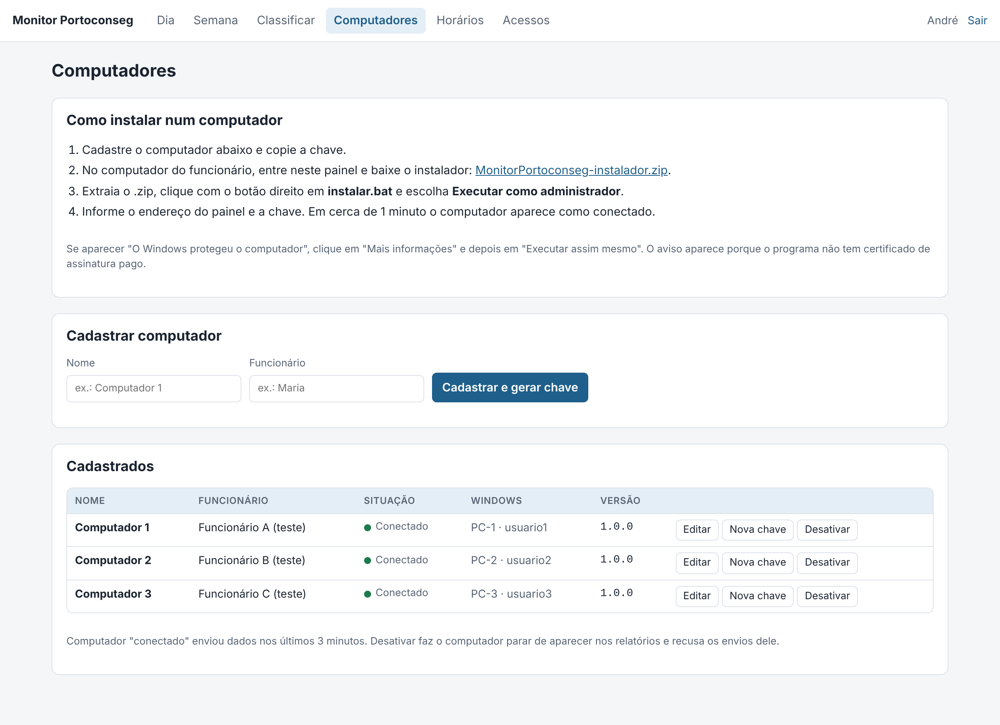
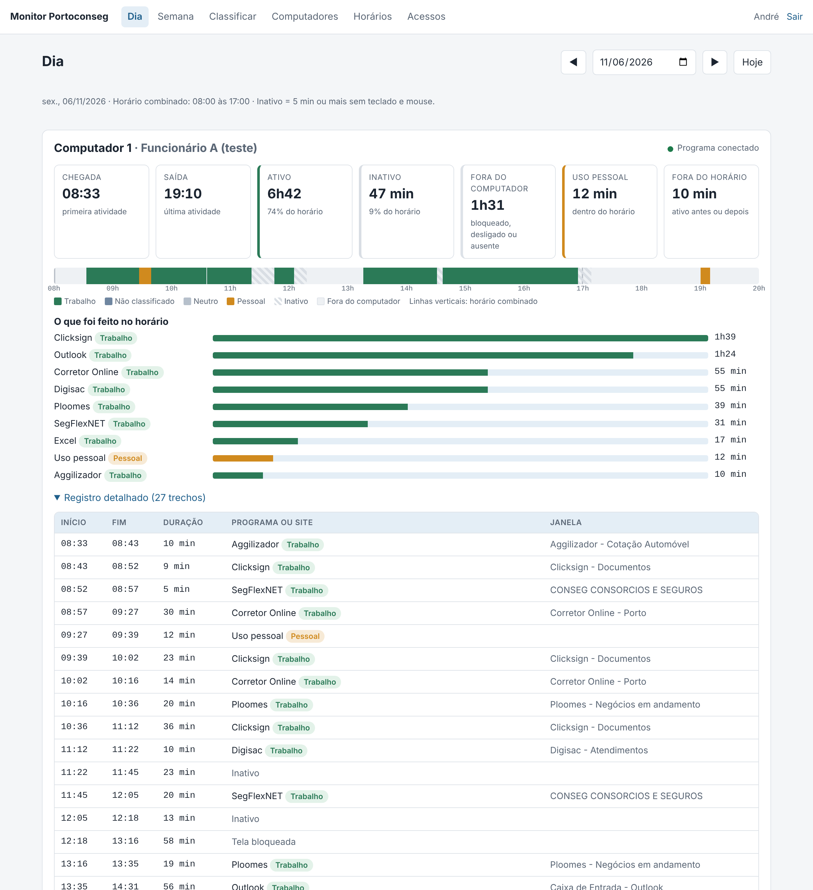

# Monitor Portoconseg — guia de instalação

Para André e Renata. Leva cerca de 30 minutos na primeira vez.

São 4 partes, nesta ordem:

1. Criar o endereço `monitor.portoconseg.com.br` (hPanel, 5 minutos)
2. Instalar o servidor no VPS (terminal do hPanel, 10 minutos)
3. Entrar no painel e cadastrar os computadores
4. Instalar o programa em cada computador

> As imagens do painel neste guia usam dados de exemplo inventados.

---

## 1. Criar o endereço do painel

1. No hPanel, abra **VPS → Gerenciar** e anote o **IP** do servidor (aparece na Visão geral).
2. Vá em **Domínios → portoconseg.com.br → DNS / Nameservers → Registros DNS**.
3. Adicione um registro:
   - **Tipo:** A
   - **Nome:** `monitor`
   - **Aponta para:** o IP anotado no passo 1
   - **TTL:** deixe o padrão
4. Salve. Normalmente vale em poucos minutos; a Hostinger avisa que pode levar até 24 horas.

Fonte: [Hostinger — como gerenciar registros A](https://www.hostinger.com/support/4468886-how-to-manage-a-records-at-hostinger/)

## 2. Instalar o servidor no VPS

1. No hPanel, abra **VPS → Gerenciar** e clique em **Terminal** (também chamado de "Web Console"). Abre uma aba nova; se não abrir, libere pop-ups do hpanel.hostinger.com.
   Fonte: [Hostinger — terminal do navegador](https://www.hostinger.com/support/7978544-how-to-use-the-browser-terminal-in-hostinger/)
2. Cole os dois comandos abaixo, um de cada vez, e tecle Enter:

```bash
: ; curl -fsSLo instalar.sh https://raw.githubusercontent.com/anata79/REPOSITORIO/main/deploy/instalar-servidor.sh ; echo fim
```

```bash
: ; bash instalar.sh monitor.portoconseg.com.br ; echo fim
```

   O terminal da Hostinger acrescenta caracteres invisíveis no começo e no fim do que é colado. O `: ;` no início e o `; echo fim` no final absorvem esses caracteres: aparece um "command not found" no começo, e isso é esperado.

   Digite a senha root só quando o terminal pedir "Password:". Se ele já abrir em `root@...:~#`, você já está dentro.

3. O instalador:
   - confere se o endereço já aponta para o VPS (se ainda não apontar, avisa e pergunta se continua);
   - instala o Docker, baixa o sistema e liga tudo (a primeira vez leva alguns minutos);
   - pede a **senha do André** e depois a **senha da Renata** (mínimo 8 caracteres). As letras não aparecem enquanto você digita: é normal.
4. No fim aparece "Pronto". Abra **https://monitor.portoconseg.com.br**.

Se o navegador reclamar do certificado logo no começo, espere 1 ou 2 minutos: o cadeado (HTTPS) é emitido automaticamente.

**Firewall da Hostinger:** se você ativou o firewall do VPS no hPanel, libere as portas **80** e **443**.

## 3. Painel: cadastrar os computadores

1. Entre com seu login (`andre` ou `renata`).
2. Abra **Computadores**.
3. Para cada máquina, preencha **Nome** (ex.: Computador 1) e **Funcionário**, e clique em **Cadastrar e gerar chave**.
4. Copie a chave que aparece. **Ela só aparece uma vez.** Se perder, use "Nova chave" e reinstale o programa naquela máquina.



## 4. Instalar o programa em cada computador

Faça em cada um dos 3 computadores, com um usuário administrador do Windows:

1. No computador, abra o painel, entre com seu login, vá em **Computadores** e clique em **MonitorPortoconseg-1.0.0-instalador.zip** para baixar (o número muda a cada versão; veja [HISTORICO-DE-VERSOES.md](../HISTORICO-DE-VERSOES.md)).
2. Clique com o botão direito no .zip → **Extrair tudo**.
3. Na pasta extraída, clique com o botão direito em **instalar.bat** → **Executar como administrador**.
4. Se aparecer **"O Windows protegeu o computador"**, clique em **Mais informações → Executar assim mesmo**. Esse aviso aparece porque o programa não tem certificado de assinatura pago.
5. Informe:
   - **Endereço do painel:** `https://monitor.portoconseg.com.br`
   - **Chave:** a chave daquele computador
6. O instalador confere a chave, copia o programa, adiciona a exceção no Windows Defender e configura para iniciar com o Windows.
7. Confira o **ícone azul com um visto** ao lado do relógio (pode estar escondido na setinha ^). Passando o mouse, aparece a versão instalada.
8. No painel, em **Computadores**, a máquina aparece como **Conectado** em cerca de 1 minuto. Os primeiros dados aparecem em **Dia** em cerca de 6 minutos.

### O que o programa faz e não faz

| Faz | Não faz |
|---|---|
| Registra horários de atividade, inatividade (5 min sem teclado e mouse) e tela bloqueada | Não registra o que é digitado |
| Registra o programa, o site e o título da janela em uso nos sistemas de trabalho | Não tira fotos da tela nem grava vídeo |
| Em uso pessoal, registra só o tempo | Não lê conversas, e-mails ou arquivos |
| Guarda os dados no computador se a internet cair e envia depois | Não pergunta nada ao funcionário |

## Depois de instalar

1. **Classificar:** nos primeiros dias, abra **Classificar**. O SegFlexNET, o Aggilizador e os sites que ainda não estão na lista aparecem ali. Um clique em **Trabalho**, **Pessoal** ou **Neutro** resolve.
2. **Horários:** para mudar o horário combinado, abra **Horários**, escolha a data a partir da qual vale e salve. Os relatórios de datas anteriores continuam com o horário antigo.
3. **Fechamento:** toda segunda, abra **Semana**: ela já abre na semana que terminou.



## Problemas comuns

| Sintoma | O que fazer |
|---|---|
| Computador aparece "Nunca conectou" | Confira o ícone azul ao lado do relógio. Se não estiver lá, saia da conta do Windows e entre de novo. |
| Ícone aparece, mas painel mostra último contato antigo | Internet da máquina ou endereço errado. O programa guarda os dados e envia quando voltar. Registro em `%LOCALAPPDATA%\MonitorPortoconseg\agente.log`. |
| "Chave recusada" no registro | A chave foi trocada no painel. Gere uma nova chave e rode o instalar.bat de novo. |
| Antivírus bloqueou o programa | Libere a pasta `C:\Program Files\MonitorPortoconseg` no antivírus. |
| Sites aparecem como "Navegador (site não identificado)" | O navegador não respondeu à leitura do endereço. Avise para eu ajustar; acontece com navegadores pouco comuns. |

## Manutenção no VPS

Atualizar para uma versão nova (os dados são mantidos):

```bash
bash /opt/monitor-portoconseg/deploy/atualizar.sh
```

Trocar a senha de alguém:

```bash
cd /opt/monitor-portoconseg/deploy && docker compose exec -it app ./Monitor.Server usuario-senha andre
```

Cópias do banco: o servidor guarda uma cópia por dia, as 14 mais recentes, dentro do volume de dados. Registros com mais de 90 dias são apagados automaticamente.

## Remover de um computador

Na pasta do instalador, botão direito em **desinstalar.bat → Executar como administrador**.
