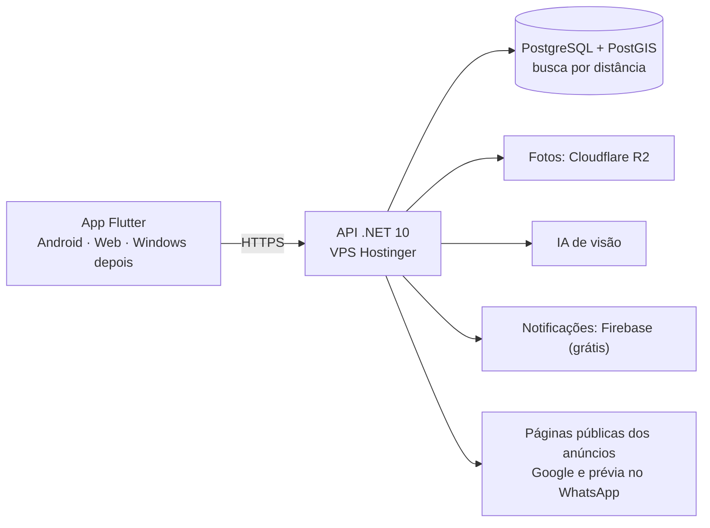

# App de Doações — planejamento e viabilidade

Projeto pessoal de André · levantamento de 09/11/2026 · versão 1 (para discussão)

> **Como ler as fontes:** neste ambiente os sites oficiais (gov.br, planalto.gov.br, camara.leg.br, support.google.com, transparency.meta.com) **não abriram**. As informações deles foram obtidas por busca, que devolve trechos dessas páginas, e por fontes secundárias (escritórios de advocacia, Jusbrasil, imprensa). Cada linha diz de onde veio. **Antes de decidir qualquer coisa jurídica, confirme com advogado.** Este documento não é parecer jurídico.

## 1. Resposta curta

1. **Objetos, roupas, brinquedos e equipamentos: viável.** A lei já protege bem o doador: na doação ele só responde por **dolo** (Código Civil, art. 392) e não responde por defeito oculto (art. 552). O risco é de mercado, não jurídico. Já existe concorrência gratuita forte: grupos "Doações [cidade]" e Marketplace do Facebook.
2. **Medicamentos de pessoa para pessoa: não recomendo, do jeito que você descreveu.** É a parte de maior risco para o próprio doador que você quer proteger:
   - **Remédio controlado** (tarja preta e outros da Portaria 344/98): a Lei de Drogas pune quem **"fornecer drogas, ainda que gratuitamente"** sem autorização, com 5 a 15 anos (art. 33).
   - **Qualquer remédio:** o Código Penal pune quem distribui ou entrega a consumo produto medicinal alterado ou "de procedência ignorada" (art. 273). Há divergência nos tribunais sobre a pena.
   - **Posição da Anvisa (2021):** foi contra o projeto de lei federal de doação de medicamentos, porque remédio que passou pela casa de alguém perde o controle de armazenamento e transporte. O projeto (PL 4091/2019) está parado na Câmara.
   - **Meta (Facebook e Instagram):** proíbe doar remédio, **com ou sem receita**.
   - **Google Play:** proíbe app que facilite obter remédio de receita sem receita.
3. **O caminho legal para medicamentos existe, mas é outro:** a **Farmácia Solidária**. Um farmacêutico recebe, confere validade e conservação, e entrega com receita. O app pode **encaminhar** o doador até ela, sem **intermediar** remédio entre pessoas (seção 4).
4. **Publicidade sozinha paga a hospedagem, não paga o projeto.** Simulação na seção 9: 10 mil usuários ativos por mês rendem algo entre **US$ 64 e 267/mês**. Referência real: o Trash Nothing + Freecycle, app global de doação, teria receita estimada **abaixo de US$ 10 mil/mês** no iPhone, 100% de anúncios (estimativa de terceiros).
5. **Ordem recomendada:** validar sem código numa cidade → app de objetos (Android + web) → IA nas fotos + anúncios → medicamentos só via farmácia solidária e só com parecer jurídico favorável.

## 2. Onde o seu raciocínio falha

| Você disse | Problema | Ajuste |
|---|---|---|
| Começar por medicamentos e depois estender a objetos | Começa pela parte mais arriscada e menos permitida. | Começar por objetos. Medicamento por último, redesenhado. |
| "Proteger o doador de todas as formas" com um termo de responsabilidade do recebedor | Termo assinado pelo recebedor **não afasta crime** do doador nem da plataforma. Para remédio, o maior risco do doador é o próprio ato. | Proteção real vem do **desenho**: o remédio vai para um farmacêutico, não para um desconhecido. Para objetos, a lei já protege (arts. 392 e 552 do Código Civil). |
| Android e Windows | Quem doa fotografa com o celular. Um app instalado no Windows agrega pouco. | **Android + versão web.** A web já funciona no Windows, Mac e Linux. Com Flutter, o app de Windows sai do mesmo código depois, quase sem custo, e publicar na Microsoft Store é grátis. |
| "No estilo OLX / Mercado Livre" | Esses são nacionais. Doação é **hiperlocal**: ninguém atravessa o estado por um sofá grátis. Um app de doação vazio na sua cidade morre, mesmo com milhares de usuários espalhados pelo país. | Lançar **uma cidade por vez** e só expandir quando ela tiver movimento. |
| "O software tem que identificar pela foto se está em bom estado" | IA reconhece o objeto, a categoria, dano visível, lixo e remédio. **Não sabe se a TV liga** nem vê defeito interno. | IA como filtro e ajudante, mais declaração do doador, avaliação depois da entrega e botão de denúncia. |
| Se sustentar só com Google Ads | Conta da seção 9. Ainda há restrição de anúncios em conteúdo de remédio (AdMob) e proibição de usar dado de saúde para vantagem econômica (LGPD, art. 11, §4º). | Anúncios cobrem a infraestrutura. Para crescer: patrocínio local, empresas doando excedentes (B2B), prefeituras, assinatura opcional. |
| Hospedar no VPS da Hostinger | Serve para começar. Mas é o **mesmo KVM 1** do Monitor Portoconseg (1 vCPU, 4 GB RAM, 50 GB) e **expira em 06/02/2027 sem renovação automática**. | Fotos fora do VPS (Cloudflare R2). Ativar renovação automática. Medir uso e subir de plano quando precisar. |
| (Implícito) Usar a base de clientes da Portoconseg para divulgar | Os dados foram coletados para consórcio e seguro. Usá-los para outro projeto exige base legal compatível (LGPD). | Convidar só quem aceitar receber (opt-in). Projeto e marca separados da corretora, para separar riscos. |

## 3. Medicamentos: o que a lei e as plataformas dizem

| Fato | O que significa para o app | Fonte (tipo) |
|---|---|---|
| Anvisa, voto de 2021 sobre o PL 4091/2019: contrária ao texto original. Trecho: medicamentos "deixam as farmácias ou drogarias ao serem adquiridos por pessoa física, perde-se o monitoramento das condições de transporte e armazenamento". Cita a Nota Técnica nº 68/2020. | O órgão regulador vê doação vinda de pessoa física como problema de qualidade. | Voto CD 38/2021, gov.br (trecho via busca; PDF não abriu aqui) |
| PL 4091/2019 (diretrizes para distribuir medicamentos doados): parado na Comissão de Seguridade Social, aguardando novo relator. | Não há lei federal que autorize doação entre pessoas. | camara.leg.br (via busca) |
| RDC 471/2021, art. 21, alterado pela RDC 973/2025: proíbe pessoa física de devolver a farmácias medicamentos com as substâncias listadas em Instrução Normativa (antimicrobianos). | Nem a farmácia pode receber antibiótico de volta de pessoa física. | normasbrasil, legisweb (secundárias) |
| Lei 11.343/2006, art. 33: crime "fornecer drogas, ainda que gratuitamente", sem autorização. "Droga" é o que está nas listas da Portaria 344/98, incluindo remédios controlados. Pena de 5 a 15 anos. | Doar tarja preta = risco de tráfico, mesmo sem lucro. **Bloqueio absoluto.** | legjur, TJDFT (secundárias) |
| Código Penal, art. 273: pune quem "distribui ou entrega a consumo" produto medicinal alterado, com valor terapêutico reduzido ou de procedência ignorada (§1º-B). Modalidade culposa: 1 a 3 anos (§2º). O STF declarou desproporcional a pena de 10 a 15 anos só para produto sem registro (Tema 1003). Para os demais incisos, a jurisprudência diverge. | Remédio guardado no calor perde eficácia. Quem doa e quem intermedeia ficam expostos. | Jusbrasil, Juspodivm, Lex (secundárias) |
| Exceção de 2024: a Anvisa autorizou temporariamente doações ao Rio Grande do Sul, de pessoas físicas **só se compradas direto de fabricante ou distribuidor**. | Mesmo na emergência, sobra de casa não foi aceita. | Economic News Brasil |
| Lei RS 15.339/2019 (Programa Solidare – Farmácia Solidária): recebe doações, com farmacêutico responsável e dispensação em farmácia habilitada. Santa Catarina tem Nota Técnica 008/2022 sobre farmácias solidárias. Muitos municípios têm leis próprias. | **Modelo legal que já existe.** O app pode trabalhar a favor dele. | saude.rs.gov.br, cosemssc.org.br |
| Decreto 10.388/2020: farmácias e drogarias são pontos de coleta de remédio vencido ou sem uso. | O app pode mostrar onde descartar. | senado.leg.br |
| Meta (padrões da comunidade): proíbe comprar, vender, trocar, **doar** ou presentear remédio de receita e também **isento de prescrição**. Exceção para crises. | As grandes plataformas fecharam essa porta de propósito. | transparency.meta.com (via busca) |
| Google Play: proíbe app que facilite compra ou venda de remédio de receita sem receita. AdMob: "Prescription Drugs" está entre as categorias com veiculação de anúncios restrita. | Risco de o app ser removido da loja e de os anúncios renderem menos. | I-Programmer, PCWorld, central do AdMob (via busca) |
| LGPD: pedir um remédio revela dado de saúde, que é **dado sensível** (art. 5º, II). Exige consentimento específico e destacado (art. 11, I). É vedado o uso compartilhado de dado de saúde para obter vantagem econômica (art. 11, §4º). | Seção de remédio no app = dado sensível + proibição de segmentar anúncio por saúde. | Manuais da LGPD de MG e Procon-SP (lei no Planalto não abriu aqui) |

**Conclusão:** o app **nunca** deve mostrar o remédio de uma pessoa física para outra pessoa física. A IA bloqueia fotos de remédio no fluxo de objetos e oferece o caminho da seção 4.

## 4. Medicamentos redesenhados: encaminhar, não intermediar

Só na fase 3, e só com parecer de advogado da área sanitária e conversa com a vigilância sanitária do município.

1. **Mapa:** farmácias solidárias e pontos de coleta de remédio vencido perto do usuário.
2. **Parceria com 1 farmácia solidária** (prefeitura, universidade ou ONG). O doador agenda a entrega **na farmácia**. O farmacêutico decide o que aproveitar.
3. **Quem precisa** é direcionado à farmácia solidária ou ao SUS, com receita. O app não mostra estoque de remédio por pessoa.
4. **Nada de controlados nem antibióticos** no app, nem como pedido.

Resultado: o doador entrega a um profissional habilitado, não a um desconhecido. É isso que realmente o protege.

## 5. Já existe? Concorrência

| Nome | Onde | O que faz | Situação conhecida | Fonte |
|---|---|---|---|---|
| Grupos "Doações [cidade]" + Marketplace | Brasil | Doação gratuita de objetos | **Concorrente real**: gratuito e com milhões de usuários. Proíbe remédios. | Meta (via busca) |
| Tem Açúcar? | Brasil | Empréstimo, doação e troca entre vizinhos | 18 mil usuários em 580 cidades (2016); estudo cita 180 mil (2019). Situação atual não confirmada. | Brazil Journal, Redalyc |
| Uma Ajuda Boa | Brasil | Doador → instituições | 12 instituições em 2019. Situação atual não confirmada. | Portal In, Diário do Nordeste |
| Paraná Solidário | Brasil (gov. PR) | Doadores → entidades, em campanhas | 460 doadores e 240 entidades (data não confirmada). | parana.pr.gov.br |
| PegMed | Brasil | **Empresas** (indústria, farmácia, distribuidora) → instituições filantrópicas, com medicamento dentro da validade | B2B, não pessoa física. Situação atual não confirmada. | Gust |
| App da BASF | Brasil | Evitar destruição de remédios da indústria | Data e situação não confirmadas. | Medicina S/A |
| Geev | França | Doação de objetos e comida | Anúncios + assinatura **GEEV Plus** (US$ 34,99/ano na App Store). Captou 4,5 M€ para atender empresas. | App Store, JDN, Le Journal des Entreprises |
| Olio | Reino Unido | Comida e objetos entre vizinhos | 5 a 6 milhões de usuários. Gratuito + premium + taxa cobrada de varejistas. **Validou a ideia com um grupo de WhatsApp.** | Sifted, Indie Hackers |
| Trash Nothing + Freecycle | EUA/global | Objetos | Anúncios + premium (US$ 1,99/mês). Receita estimada < US$ 10 mil/mês no iOS. Freecycle: mais de 9 milhões de pessoas (2020). | help.trashnothing.com, AppGoblin, Salon |
| Farmácias Solidárias | Municípios / RS | Recebem e dispensam remédios doados, com farmacêutico | Não são app. **Possíveis parceiras.** | Lei RS 15.339/2019 |

**Lacuna real:** não encontrei um app brasileiro ativo e conhecido de doação de objetos entre pessoas com IA nas fotos, foco local e proteção do doador. Mas "não encontrei" não significa que não existe: busque na Play Store por "doação" antes de investir.

**Diferenciais possíveis** (para justificar trocar o grupo do Facebook pelo seu app):
- Anunciar em 30 segundos: tira a foto e a IA preenche título, categoria e estado.
- O doador escolhe para quem doar, o que dificulta revendedores que pegam tudo de graça para vender.
- Telefone e endereço nunca aparecem: chat dentro do app e localização só por bairro.
- Contador de impacto: itens doados e quilos que não foram para o lixo.

## 6. O que o app faz (primeira versão: só objetos)

**Para o doador**
- Cadastro com Google ou e-mail, **18 anos ou mais**. O ECA Digital (Lei 15.211/2025) está em vigor desde 17/03/2026 e a fiscalização começa em 2027. Confirmar com advogado o que se aplica a um app só para adultos.
- Anunciar: até 5 fotos, a IA sugere categoria, título e estado, e o doador confirma.
- Forma de entrega: "retire aqui", "posso levar" ou "ponto de encontro".
- Recebe pedidos de interesse e **escolhe** quem recebe.
- Chat interno, confirmação de entrega, avaliação e bloqueio.

**Para quem recebe**
- Feed por distância e categoria, alertas ("avise quando aparecer carrinho de bebê").
- Limite de pedidos por semana, contra revendedores.
- Avaliação depois da retirada.

**Para você (moderação)**
- Fila de anúncios que a IA marcou como duvidosos, denúncias, banimento.
- Lista de itens proibidos: remédios, armas, animais, alimentos perecíveis, produtos íntimos usados, cosméticos abertos, itens com recall.

**Proteção do doador, na prática**
1. Telefone, endereço e sobrenome nunca aparecem.
2. Localização aproximada (bairro), nunca o ponto exato.
3. Dicas de encontro seguro: lugar público, de dia, acompanhado.
4. O doador escolhe quem recebe e pode bloquear.
5. Termos de uso: o item é entregue no estado em que está, e o recebedor declara que examinou.
6. Lei: o doador só responde por dolo (art. 392) e não responde por defeito oculto (art. 552). Um projeto no Senado (PL 4/2025) propõe mudar a redação do art. 552; não confirmei se foi aprovado.
7. Plataforma: o STF mudou em 2025 a responsabilidade dos provedores (art. 19 do Marco Civil). Agora há dever de cuidado e de remover conteúdo ilícito após notificação. Por isso a moderação e o botão de denúncia são obrigatórios desde a primeira versão.

## 7. Fotos e IA: o que dá, o que não dá e quanto custa

Ao enviar o anúncio, um modelo de visão devolve: categoria, título, descrição curta, estado aparente (novo / bom / com marcas / ruim), se é item proibido, se é remédio e se parece lixo. Casos duvidosos vão para a sua fila.

Custo estimado por anúncio (3 fotos reduzidas, ~5.500 tokens de entrada e ~300 de saída), pela tabela da Anthropic de 06/10/2026:

| Modelo | Preço (entrada / saída por milhão de tokens) | Custo por 1.000 anúncios |
|---|---|---|
| Claude Haiku 5.5 | US$ 0,10 / 0,50 | ~US$ 0,70 (até ~1,70 com fotos em resolução máxima) |
| Claude Sonnet 5.5 | US$ 2 / 10 | ~US$ 14 |
| Claude Opus 5.5 | US$ 4 / 20 | ~US$ 28 |

Premissa: até ~1.600 tokens por foto reduzida e até 4.784 em resolução máxima. Os modelos de 2026 "pensam" antes de responder, e isso aumenta a saída. **Teste com 100 fotos reais** e fique com o mais barato que acertar.

Alternativa do Google (Cloud Vision): rotulagem grátis até 1.000 imagens/mês, depois US$ 1,50 por 1.000, com checagem de conteúdo impróprio inclusa. Ela identifica o objeto e conteúdo impróprio, mas não monta o anúncio nem avalia estado.

## 8. Tecnologia e hospedagem

| Parte | Escolha | Por quê |
|---|---|---|
| App | **Flutter** | Um código só para Android, iOS, web, Windows, macOS e Linux. iOS e macOS exigem um Mac para compilar. |
| Servidor | **C# / .NET 10 + PostgreSQL + Caddy em Docker Compose** | **Mesma base do Monitor Portoconseg**, no mesmo VPS: uma tecnologia só para manter. |
| Busca por perto | PostGIS | Anúncios por distância, sem pagar API de mapas. |
| Chat | SignalR (.NET) | Tempo real, no próprio servidor. |
| Fotos | Cloudflare R2 | 10 GB grátis e saída de dados sem custo. Fotos comprimidas (~0,5 MB por anúncio) cabem em ~20 mil anúncios. Não lota o disco do VPS. |
| Páginas de anúncio | HTML gerado pelo servidor | Link compartilhado no WhatsApp mostra foto e título, e o Google indexa ("doação de sofá em [cidade]"). |
| Dados | VPS em Campinas/SP | Dados ficam no Brasil. |

**O VPS aguenta?** Para a primeira cidade, provavelmente sim, junto com o Monitor (os dois são leves). Não há número confiável de usuários por plano. Regra prática: medir CPU e memória e subir de plano quando o uso passar de 70% de forma contínua.

## 9. Dinheiro: custos e receita

### Custos do primeiro ano

| Item | Custo | Observação |
|---|---|---|
| Conta Google Play | US$ 25, uma vez | Conta pessoal exige **teste fechado com 12 testadores por 14 dias seguidos** antes de publicar. Conta de empresa é isenta, mas precisa de CNPJ e número D-U-N-S. |
| Microsoft Store | Grátis | Para pessoa física, desde 2025. |
| Apple (iPhone) | US$ 99/ano + um Mac | Só quando houver demanda. |
| VPS KVM 1 | Já pago; renovação R$ 815,88/ano | Compartilhado com o Monitor. |
| Domínio .com.br | ~R$ 40/ano | Fonte secundária; confirmar no Registro.br. |
| Fotos (R2) | R$ 0 até 10 GB | Depois, US$ 0,015 por GB/mês. |
| IA nas fotos | US$ 0,70 a 28 por 1.000 anúncios | Depende do modelo (seção 7). |
| Notificações (Firebase) | Grátis | |
| Advogado (sanitário + LGPD + termos) | Pedir orçamento | **Indispensável** antes da fase 3 e recomendável antes de lançar. |
| Registro de marca (INPI) | Consultar tabela do INPI | Pesquisar o nome antes de divulgar. |
| Código | Eu escrevo | Teste em aparelho real, suporte e moderação ficam com você. |

### Receita com anúncios: simulação

Premissas (hipotéticas): cada usuário abre o app 8 vezes por mês, vê 3 banners por visita e 1 tela cheia a cada 2 visitas. Valores pagos por mil exibições no Brasil (eCPM, fontes de terceiros, não do Google): banner US$ 0,10–0,50, tela cheia US$ 1–3,67.

| Usuários ativos/mês | Banners | Tela cheia | Total/mês |
|---|---|---|---|
| 1.000 | US$ 2–12 | US$ 4–15 | **US$ 6–27** |
| 10.000 | US$ 24–120 | US$ 40–147 | **US$ 64–267** |
| 100.000 | US$ 240–1.200 | US$ 400–1.468 | **US$ 640–2.668** |

Contra a conta: nem todo espaço é preenchido por anúncio, tela cheia irrita quem está doando e há restrição em conteúdo de remédio. Valores em dólar, sem conversão: faça a conta no câmbio do dia.

**Outras receitas, com exemplos reais:**
- Assinatura opcional: mais alcance, sem anúncios (Geev, Trash Nothing).
- Empresas e varejo pagam para doar excedentes e receber relatório de impacto (Olio, Geev B2B).
- Prefeituras: versão para campanhas (agasalho, volta às aulas).
- Patrocínio local: "doações deste mês apoiadas por...".
- Se virar associação sem fins lucrativos: **Google Ad Grants** dá até US$ 10 mil/mês em anúncios no Google, para divulgação e não como receita. A validação no Brasil é feita por parceiro do Google (a TechSoup parou em 2023). Confirmar elegibilidade.

## 10. Etapas

| Fase | Duração estimada | O que inclui | O que exige | Passa para a próxima se... |
|---|---|---|---|---|
| **0. Validar sem código** | 3–4 semanas | Grupo de WhatsApp/Instagram num bairro ou cidade, doações intermediadas à mão (como fez a Olio). Pesquisa de nome no INPI e domínio. Conversa com contador sobre CNPJ próprio ou associação. Primeira consulta jurídica. | Seu tempo, celular, ~R$ 40 de domínio. | **Meta sugerida:** 40 doações concluídas em 30 dias e 12 voluntários para o teste da Play Store. |
| **1. App de objetos** | 8–12 semanas | Android + web: cadastro, anúncio com fotos, busca por distância, interesse, escolha do recebedor, chat, entrega, avaliação, denúncia, moderação, termos e privacidade. | Conta Play (US$ 25), 12 testadores por 14 dias, VPS, R2, Firebase. | Metade dos anúncios vira doação em até 7 dias; usuários voltam no mês seguinte. |
| **2. IA + anúncios + mais plataformas** | 4–6 semanas | IA nas fotos, reputação, alertas, AdMob (banner e nativo), Windows na Microsoft Store se houver pedido, iOS se houver verba. | Conta na API de IA, conta AdMob. | Custos cobertos ou patrocinador local. |
| **3. Medicamentos (encaminhamento)** | 4 semanas | Mapa de coleta e farmácias solidárias, parceria com 1 farmácia solidária, agendamento de entrega. | **Parecer jurídico favorável** e farmácia parceira. | Parceiro operando. |
| **4. Escala e receita** | Contínuo | Nova cidade só quando a anterior se sustenta; B2B, prefeituras, assinatura. | Pessoa dedicada à parceria e à moderação. | — |

## 11. Divulgação: chegar a quem doa e a quem precisa

**Quem precisa** (o lado mais difícil de alcançar):
- CRAS e assistência social do município, igrejas, ONGs, associações de bairro, escolas públicas.
- Cartaz com QR code em pontos de grande circulação: UBS, igrejas, mercados de bairro.
- Indicação boca a boca: quem recebeu indica.

**Quem doa:**
- Síndicos e grupos de condomínio ("antes de jogar fora, anuncie").
- Mudanças: parceria com imobiliárias e empresas de mudança.
- Mães e pais (roupa e brinquedo que perdem rápido): grupos de escola e creche.
- Campanhas na data certa: agasalho (inverno), volta às aulas (janeiro), Dia das Crianças, Natal, emergências.

**Conteúdo e imprensa:**
- Vídeos curtos de histórias reais ("o berço que foi para a Maria em 2 horas"), com autorização.
- TV, rádio e jornal locais gostam desse tipo de pauta: mídia de graça.
- Páginas do site por cidade e categoria, para aparecer no Google.
- Contador público de impacto (itens doados, quilos que não foram para o lixo).

**Divulgação a evitar:**
- Mandar mensagem em massa para clientes da corretora sem consentimento (LGPD).
- Expandir para várias cidades ao mesmo tempo antes de uma funcionar.

## 12. Riscos principais

| Risco | Probabilidade | Mitigação |
|---|---|---|
| Ninguém usa (app vazio) | Alta | Fase 0, uma cidade por vez, parceiros que trazem os dois lados. |
| Revendedores pegam tudo de graça | Alta | Doador escolhe quem recebe, limite semanal, avaliação, denúncia. |
| Remédio anunciado como objeto | Média | IA bloqueia, item proibido nos termos, moderação. |
| Golpe ou encontro inseguro | Média | Chat interno, sem telefone, local aproximado, dicas de segurança, banimento. |
| Remoção da Play Store | Baixa sem remédio; alta com remédio | Fora de remédio entre pessoas. |
| Moderação toma seu tempo | Alta quando crescer | IA filtra, voluntários moderadores, regras claras. |
| VPS expira | Certa em 06/02/2027 se nada for feito | Ativar renovação automática. |

## 13. Decisões suas

1. Aceita começar **só por objetos**, deixando medicamentos para a fase 3 via farmácia solidária?
2. Plataformas: **Android + web** primeiro (Windows depois, pela Microsoft Store)?
3. Cidade (ou bairro) de lançamento?
4. Estrutura: CNPJ próprio, associação sem fins lucrativos ou, por enquanto, pessoa física? (Falar com contador.)
5. Nome do projeto: pesquisar no INPI antes de divulgar.
6. Topa rodar a **fase 0 (grupo de WhatsApp) por 30 dias** antes de eu começar o código?

## Fontes

**Medicamentos e legislação**
- Anvisa, voto CD 38/2021 sobre o PL 4091/2019 (trecho via busca): https://www.gov.br/anvisa/pt-br/composicao/diretoria-colegiada/reunioes-da-diretoria/votos-dos-circuitos-deliberativos/cd-38-2021-voto.pdf
- PL 4091/2019: https://www.camara.leg.br/propostas-legislativas/2212149
- RDC 471/2021: https://www.normasbrasil.com.br/norma/resolucao-471-2021_409766.html
- RDC 973/2025: https://www.legisweb.com.br/legislacao/?id=477177
- Lei 11.343/2006, art. 33: https://www.legjur.com/legislacao/art/lei_00113432006-33 · https://www.tjdft.jus.br/institucional/imprensa/campanhas-e-produtos/direito-facil/edicao-semanal/trafico-ilicito-de-drogas
- Código Penal, art. 273: https://www.jusbrasil.com.br/topicos/10604224/paragrafo-1-artigo-273-do-decreto-lei-n-2848-de-07-de-dezembro-de-1940
- STF, Tema 1003 (RE 979962): https://meusitejuridico.editorajuspodivm.com.br/2021/03/25/stf-e-inconstitucional-pena-de-reclusao-de-10-15-anos-cominada-para-importacao-de-medicamento-sem-registro/ · https://www.lex.com.br/supremo-estende-tese-sobre-pena-por-importacao-de-medicamento-sem-registro-sanitario/
- Anvisa, doações ao RS em 2024: https://economicnewsbrasil.com.br/2024/05/30/rio-grande-do-sul-anvisa-autoriza-doacao-urgente-de-medicamentos/
- Lei RS 15.339/2019 (Solidare): https://admin.saude.rs.gov.br/upload/arquivos/202203/14114548-lei-n-15339-de-2-de-outubro-de-2019pdf.pdf
- SC, Nota Técnica 008/2022 (farmácias solidárias): https://www.cosemssc.org.br/wp-content/uploads/2022/03/Nota-Tecnica-no.-008.2022-–-DIVS.SUV_.SES_.SC-Farmacias-Solidarias.pdf
- Decreto 10.388/2020: https://legis.senado.leg.br/norma/32242999/publicacao/32243981
- Meta, bens e serviços restritos (via busca): https://transparency.meta.com/pt-br/policies/community-standards/restricted-goods-services/
- Google Play, remédios de receita: https://i-programmer.info/news/193-android/6298-google-strengthens-content-policies.html · https://www.pcworld.com/article/422613/google-removes-medical-marijuana-app-from-play-store.html
- AdMob, categorias com veiculação restrita (via busca): https://support.google.com/admob/answer/9391084?hl=en
- LGPD, dados sensíveis: https://lgpd.seguranca.mg.gov.br/storage/documentos/3/x7Q2GhIZ4D81IB1OSsxQ4HgpLAvQ9TuWKih3vEEw.pdf · https://www.procon.sp.gov.br/wp-content/uploads/2025/08/Cartilha_LGPD_2025.pdf
- Código Civil, arts. 392 e 552: https://www.jusbrasil.com.br/topicos/10706156/artigo-392-da-lei-n-10406-de-10-de-janeiro-de-2002 · https://www.jusbrasil.com.br/topicos/10698101/artigo-552-da-lei-n-10406-de-10-de-janeiro-de-2002
- PL 4/2025 (Senado, novo Código Civil): https://legis.senado.leg.br/sdleg-getter/documento?dm=9889356&disposition=inline
- Marco Civil, art. 19 (STF 2025): https://www.mattosfilho.com.br/unico/responsabilizacao-provedores-internet/ · https://teletime.com.br/06/11/2025/stf-publica-decisao-sobre-o-art-19-do-marco-civil-da-internet/
- ECA Digital: https://www.machadomeyer.com.br/pt/inteligencia-juridica/publicacoes-ij/direito-digital/estatuto-digital-da-crianca-e-do-adolescente-lei-n-15-211-2025-entra-em-vigor-em-17-de-marco-de-2026 · https://www.mayerbrown.com/pt/insights/publications/2026/04/enforcement-of-brazils-eca-digital-introduces-new-obligations-for-companies

**Concorrentes**
- Tem Açúcar?: https://braziljournal.com/startups-apostam-na-economia-compartilhada · https://www.redalyc.org/journal/4990/499063350007/499063350007.pdf
- Uma Ajuda Boa: https://www.portalin.com.br/in-connection/aplicativo-uma-ajuda-boa-multiplica-esperanca-e-amor/ · https://diariodonordeste.verdesmares.com.br/projetos/seja-luz/acoes-ligam-doadores-a-instituicoes-e-ampliam-atos-de-solidariedade-1.2182343
- Paraná Solidário: https://www.parana.pr.gov.br/Audio/Aplicativo-Parana-Solidario-ja-cadastrou-460-doadores-e-240-entidades-sociais
- PegMed: https://gust.com/companies/pegmed
- App BASF: https://medicinasa.com.br/app-basf/
- Geev: https://apps.apple.com/app/id1165633060 · https://www.journaldunet.com/start-up/1528169-geev-plateforme-de-dons-d-objets-leve-4-5-millions-d-euros-pour-developper-son-offre-btob · https://www.lejournaldesentreprises.com/article/geev-en-route-vers-la-monetisation-de-sa-plateforme-137551
- Olio: https://sifted.eu/articles/olio-raises-43m · https://www.indiehackers.com/post/olio-food-sharing-app-validated-using-whatsapp-and-has-now-over-6-million-users-1e04654e9f
- Trash Nothing + Freecycle: https://help.trashnothing.com/topic/about · https://appgoblin.info/apps/680743557 · https://trashnothing.com/free-stuff-guides/best-free-stuff-apps-compared · https://www.salon.com/2020/02/28/more-than-9-million-people-are-freecycling-instead-of-buying-new_partner/
- Lista de apps de troca e doação: https://catracalivre.com.br/economize/confira-sites-e-aplicativos-que-facilitam-trocas-doacoes-e-emprestimos-de-objetos/

**Tecnologia e custos**
- Flutter, plataformas: https://docs.flutter.dev/resources/faq · https://docs.flutter.dev/platform-integration/desktop
- Google Play, taxa de US$ 25: https://support.google.com/googleplay/android-developer/answer/6112435?hl=en
- Google Play, 12 testadores por 14 dias: https://support.google.com/googleplay/android-developer/answer/14151465?hl=en-GB
- Microsoft Store grátis para pessoa física: https://blogs.windows.com/windowsdeveloper/2025/09/10/free-developer-registration-for-individual-developers-on-microsoft-store/
- Apple, US$ 99/ano: https://www.windowscentral.com/microsoft/windows-11/microsoft-store-drops-fees-for-individual-developers-apple-still-charges-usd99-per-year/
- Cloudflare R2: https://cloudflare.com/en-ca/products/r2
- Google Cloud Vision, preços: https://cloud.google.com/vision/pricing
- Firebase Cloud Messaging grátis: https://firebase.google.com/pricing
- Preços da API Claude (tabela de 06/10/2026): https://platform.claude.com/docs/en/about-claude/pricing
- Hostinger, limites do KVM 1: https://www.hostinger.com/support/6976044-parameters-and-limits-of-hosting-plans-in-hostinger/
- Domínio .com.br (secundária): https://www.tecmundo.com.br/internet/405860-descubra-quanto-custa-um-dominio-de-site-e-como-registrar-o-seu.htm
- eCPM no Brasil (terceiros): https://appodeal.com/blog/mobile-ecpm-report-app-ad-monetization-worldwide-performance · https://revenueflex.com/blog/app-monetization-emerging-markets-strategy/ · https://mwm.ai/glossary/ecpm
- Google Ad Grants: https://www.google.com/intl/es_ar/grants/faq/ · https://support.google.com/nonprofits/answer/7341468?hl=en · https://support.techsoup.org/hc/en-us/articles/47310665892123-Google-for-Nonprofits-Validations-No-Longer-Supported-by-TechSoup
- Dados do VPS do André: `docs/comparativo-ferramentas.md` e `docs/plano-monitor.md` (conferidos em 06/11/2026)
