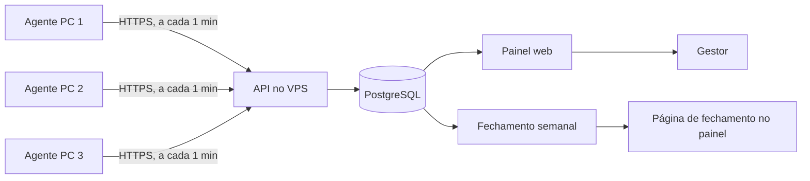

# Monitor Portoconseg — plano do sistema

Portoconseg · plano para aprovação · 06/11/2026 · versão visual: https://claude.ai/artifact/Bmr6nMr2u1vSY2kSqjq6aY

Sistema próprio para acompanhar o uso dos 3 computadores da corretora. Um programa leve roda em cada máquina, envia os dados para o VPS da Hostinger e o gestor vê tudo num painel web. Sem mensalidade.

> **Atualizado em 07/11/2026:** sem pergunta de justificativa e sem tela para o funcionário. Ele vê apenas o ícone do programa ao lado do relógio. Os relatórios aparecem só para o gestor. Objetivo: saber se o computador está em uso no horário combinado, para conhecimento próprio.
>
> **Decisões de 07/11/2026:** horário seg–qui 8h–18h, sex 8h–17h, sábado e domingo descanso. Inativo após 5 min sem teclado e mouse. Pendrive só registrado, sem bloqueio. Sistemas: sites diversos + SegFlex (instalado). Painel disponível a qualquer hora para André e Renata, com logins separados.
>
> **Decisões de 08/11/2026 (2):** registrar a janela ativa (programa, site e título da janela) nos sistemas de trabalho; no uso pessoal, só o tempo total. Login só com usuário e senha. Sem e-mail por enquanto: fechamento da semana numa página do painel, pronta toda segunda.
>
> **Decisão de 08/11/2026:** sem prints e sem vídeos. O sistema registra só programa, domínio do site e horários, e monta o relatório do dia. Uso pessoal aparece só como tempo total, sem o nome do site.

| Item | Valor |
|---|---|
| Máquinas | 3 — Windows 10 Home, Windows 11 Pro, Windows 11 Home |
| Servidor | VPS KVM 1 (ID 1340854), data center de Campinas/SP — dados ficam no Brasil |
| Licença | Zero. Custo é o VPS já contratado (renovação R$ 815,88/ano) |

## Alerta: Windows 10 Home sem atualizações de segurança

- Suporte do Windows 10 terminou em 14/10/2025.
- ESU doméstico terminou em 13/10/2026. A máquina não recebe correções.
- Máquina com dados de clientes. Ação: rodar "Verificação de Integridade do PC"; se compatível, atualizar para Windows 11; se não, planejar a troca.

## Fluxo

Classificação, verificada a cada 5 segundos, sem nenhuma pergunta ou aviso ao funcionário:

- **Ativo:** teclado ou mouse usados nos últimos 5 min → registra programa e domínio do site em uso.
- **Inativo:** 5 min ou mais sem teclado e mouse → registra só o horário.
- **Fora do computador:** tela bloqueada, PC suspenso ou desligado.

O limite de 5 min é configurável no painel.

Fila local no agente: sem internet, os dados ficam guardados e sobem quando a conexão volta.

## Entregas

1. **Base:** início automático com ícone visível; logon/logoff/bloqueio/suspensão; horários de atividade e inatividade, sem perguntas ao funcionário; programa em uso e domínio do site; jornada do dia; painel com linha do tempo e ranking de programas/sites; resumo do uso dentro do horário combinado (ativo, inativo, fora do computador).
   Inclui logins separados para André e Renata e programas instalados (ex.: SegFlex) no ranking.
2. **Relatórios e controle:** relatório do dia no painel a qualquer hora; página de fechamento da semana anterior pronta no painel toda segunda (sem e-mail por enquanto); uso pessoal só como tempo total, sem o nome do site; pendrive só registrado (conexão e arquivos copiados); classificação de programas/sites e tempo por frente de trabalho; inventário e saúde do Windows; depois, se fizer sentido, integração Ploomes e Digisac.

Registro: o agente verifica a cada 5 segundos o programa e o site em primeiro plano e grava períodos com início e fim (ex.: "Ploomes, 09:12–09:47"). Não é amostragem a cada X minutos: o tempo de cada atividade fica exato. O limite de 5 min vale só para considerar o PC inativo.

Uso pessoal: lista editável no painel (bancos, redes sociais, streaming, compras). Tempo nesses sites entra como "Uso pessoal", sem o domínio. Limite conhecido: a lista olha o site, não o conteúdo — um Gmail pessoal e um de trabalho têm o mesmo endereço.

Almoço: sem horário fixo. Aparece naturalmente como tempo inativo ou fora do computador.

Exemplo ilustrativo de relatório do dia (dados inventados):

| Computador | Chegada | Saída | Ativo | Inativo | Fora do PC | Mais usados |
|---|---|---|---|---|---|---|
| Computador 1 | 08:32 | 18:05 | 6h55 | 1h10 | 1h28 | Portais de seguradora 2h40 · Ploomes 1h50 · Digisac 1h15 · SegFlex 50min · Uso pessoal 20min |

## Recursos extras de produtividade

| Recurso | Avaliação |
|---|---|
| Tempo por frente de trabalho (cotação, atendimento, CRM, pós-venda, e-mail) | Recomendo |
| Comparação com a própria média do funcionário (sem ranking entre colegas) | Recomendo |
| Fechamento semanal numa página do painel, pronta toda segunda | Decidido |
| Uso no horário combinado: primeira/última atividade, tempo ativo, inativo e fora do PC (não substitui ponto oficial) | Núcleo |
| Blocos de foco e trocas de contexto por hora | Útil |
| Saúde das máquinas (disco, atualizações, antivírus) | Útil |
| Esforço x resultado com Ploomes | Depende de API — a confirmar |
| Atendimentos e tempo de resposta com Digisac | Depende de API — a confirmar |

**Fora de propósito:** keylogger, webcam/microfone, programa invisível, ranking público, título completo de janelas (pode conter dados de clientes; guarda-se só processo e domínio).

## Windows por máquina

| Máquina | Monitor | Bloqueio de USB | Atualizações |
|---|---|---|---|
| Windows 10 Home | Funciona | Registro (`USBSTOR\Start=4`) | Nenhuma desde 13/10/2026 |
| Windows 11 Pro | Funciona | Política de grupo | Em dia |
| Windows 11 Home | Funciona | Registro (`USBSTOR\Start=4`) | Em dia |

## Implantação

1. André: avisa os 3 funcionários (recomendado: por mensagem escrita, para ficar registrado).
2. André: ativar renovação automática do VPS (expira 06/02/2027).
3. André: criar `monitor.portoconseg.com.br` apontando para o VPS.
4. Claude: servidor, painel, agente Windows e instalador.
5. André: colar o script de instalação no terminal do VPS (hPanel).
6. André: instalar em 1 máquina e testar por 3 a 5 dias.
7. Claude: correções.
8. André: instalar nas outras 2 máquinas; seguir para a entrega 2.

## Tecnologia e segurança

- Agente e API em C# / .NET 10 (suporte até 14/11/2028; .NET 8 termina em 10/11/2026).
- PostgreSQL, Caddy com HTTPS automático, tudo em Docker Compose no VPS.
- Painel com login individual (André, Renata); chave por máquina; log de acesso; retenção de 90 dias (atividade); backup diário.
- Nenhuma imagem da tela. Sem áudio, sem webcam, sem registro de teclas. Só programa, domínio e horários.
- Login só com usuário e senha (decisão de André: sem imagens, não precisa de segunda etapa).
- Funcionário sem tela própria. Se pedir os próprios dados, o gestor exporta o relatório dele (direito de acesso, art. 18 da LGPD).
- Agente instalado em `Program Files` (gravação só por administrador) com exceção no Defender.

## Sistemas de trabalho (lista inicial)

| Tipo | Sistemas |
|---|---|
| Programas instalados | SegFlexNET, Aggilizador (Agger), pacote Office (Outlook, Word, Excel, PowerPoint, Teams) |
| Sites | Ploomes, Clicksign, Digisac, Corretor Online, Área Exclusiva, portais de seguradoras, Google Agenda, Google Keep, Hostinger, Gemini |
| Uso pessoal (inicial) | Bancos, redes sociais, streaming de vídeo e música, compras, jogos, Airbnb, Stay Life — ajustável no painel |

Sites novos aparecem como "não classificado"; André ou Renata marcam como trabalho ou pessoal no painel.

## Entrega 3 (opcional): celular Android da empresa

- App instalado por André (APK fora da Play Store), ícone visível.
- Usa a API oficial de estatísticas de uso do Android (`UsageStatsManager`), com a permissão "Acesso ao uso" liberada manualmente nas configurações do celular.
- Registra tela ligada/desligada e tempo em primeiro plano de cada aplicativo, no horário combinado; envia ao mesmo servidor e aparece no mesmo painel.
- Não registra sites, conteúdo de conversas nem ligações. Não usa serviço de acessibilidade (restrito pelo Google e invasivo).
- Limites: WhatsApp aparece só como "WhatsApp", sem saber se a conversa é de trabalho; o funcionário pode desligar a permissão (gera alerta no painel); economia de bateria de alguns fabricantes pode atrasar o envio.
- iPhone: não é viável. A Apple não deixa os dados de uso saírem do aparelho.

## Decisões de 08/11/2026 (3)

- Encaminhamento de e-mail do Outlook: configurado por André, intencional.
- Airbnb e Stay Life: uso pessoal.
- Sem termo de ciência assinado: André avisa os funcionários. Recomendação registrada: aviso por mensagem escrita, para ter prova de que avisou.

## Decisões pendentes

- Celular Android: incluir como entrega 3?
- Lista de sites e sistemas por frente de trabalho (André vai enviar)

## Fontes

- Windows 10 fim de suporte: https://learn.microsoft.com/windows/release-health/release-information
- ESU Windows 10: https://learn.microsoft.com/windows/whats-new/extended-security-updates
- ESU doméstico até 13/10/2026: https://learn.microsoft.com/answers/a/12172995
- Suporte .NET: https://learn.microsoft.com/dotnet/core/releases-and-support
- Bloqueio de USB em edições Home: https://learn.microsoft.com/troubleshoot/windows-server/group-policy/removable-devices-group-policy-troubleshooting-guidance
- GetLastInputInfo: https://learn.microsoft.com/windows/win32/api/winuser/nf-winuser-getlastinputinfo
- Isolamento da sessão 0: https://learn.microsoft.com/windows/win32/services/service-changes-for-windows-vista
- Exceções no Defender: https://learn.microsoft.com/defender-endpoint/microsoft-defender-antivirus-exclusions-configure
- Limites do KVM 1: https://www.hostinger.com/support/6976044-parameters-and-limits-of-hosting-plans-in-hostinger/
- ANPD, Guia de Legítimo Interesse: https://www.gov.br/anpd/pt-br/centrais-de-conteudo/materiais-educativos-e-publicacoes/copy_of_guia_legitimo_interesse.pdf/@@display-file/file
