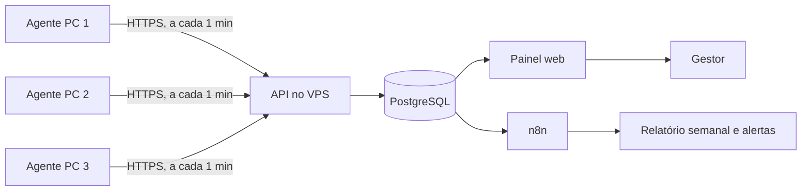

# Monitor Portoconseg — plano do sistema

Portoconseg · plano para aprovação · 06/11/2026 · versão visual: https://claude.ai/artifact/Bmr6nMr2u1vSY2kSqjq6aY

Sistema próprio para acompanhar o uso dos 3 computadores da corretora. Um programa leve roda em cada máquina, envia os dados para o VPS da Hostinger e o gestor vê tudo num painel web. Sem mensalidade.

| Item | Valor |
|---|---|
| Máquinas | 3 — Windows 10 Home, Windows 11 Pro, Windows 11 Home |
| Servidor | VPS KVM 1 (ID 1340854), data center de Campinas/SP — dados ficam no Brasil |
| Licença | Zero. Custo é o VPS já contratado (renovação R$ 815,88/ano) |

## Alerta: Windows 10 Home sem atualizações de segurança

- Suporte do Windows 10 terminou em 14/10/2025.
- ESU doméstico terminou em 13/10/2026. A máquina não recebe correções.
- Máquina com dados de clientes. Ação: rodar "Verificação de Integridade do PC"; se compatível, atualizar para Windows 11; se não, planejar a troca.

## Fluxo

Ociosidade: 5 min sem teclado/mouse → ocioso. Ao voltar depois de 10 min ou mais → janela pede justificativa (ligação com cliente, visita/reunião, pausa, outro). Valores configuráveis.

Fila local no agente: sem internet, os dados ficam guardados e sobem quando a conexão volta.

## Entregas

1. **Base:** início automático com ícone visível; logon/logoff/bloqueio/suspensão; tempo ativo e ocioso com justificativa; programa em uso e domínio do site; jornada do dia; painel com linha do tempo e ranking de programas/sites; tela "Meu dia" para o funcionário.
2. **Produtividade e segurança:** classificação produtivo/neutro/improdutivo; tempo por frente de trabalho; alertas (agente parado, USB, ociosidade longa no expediente); USB com registro e bloqueio opcional por máquina; inventário e saúde do Windows; relatório semanal no WhatsApp/e-mail via n8n.
3. **Opcionais:** print de tela desfocado, desligado por padrão, retenção máxima de 7 dias; integração Ploomes e Digisac se as APIs permitirem.

## Recursos extras de produtividade

| Recurso | Avaliação |
|---|---|
| Tempo por frente de trabalho (cotação, atendimento, CRM, pós-venda, e-mail) | Recomendo |
| Comparação com a própria média do funcionário (sem ranking entre colegas) | Recomendo |
| Relatório semanal automático (n8n no VPS) | Recomendo |
| Blocos de foco e trocas de contexto por hora | Útil |
| Meta diária combinada com o funcionário | Útil |
| Jornada e pontualidade (não substitui ponto oficial) | Útil |
| Saúde das máquinas (disco, atualizações, antivírus) | Útil |
| Esforço x resultado com Ploomes | Depende de API — a confirmar |
| Atendimentos e tempo de resposta com Digisac | Depende de API — a confirmar |

**Fora de propósito:** keylogger, webcam/microfone, programa invisível, ranking público, título completo de janelas (pode conter dados de clientes; guarda-se só processo e domínio).

## Windows por máquina

| Máquina | Monitor | Bloqueio de USB | Atualizações |
|---|---|---|---|
| Windows 10 Home | Funciona | Registro (`USBSTOR\Start=4`) | Nenhuma desde 13/10/2026 |
| Windows 11 Pro | Funciona | Política de grupo | Em dia |
| Windows 11 Home | Funciona | Registro (`USBSTOR\Start=4`) | Em dia |

## Implantação

1. André: termo revisado por advogado e assinado pelos 3 funcionários.
2. André: ativar renovação automática do VPS (expira 06/02/2027).
3. André: criar `monitor.portoconseg.com.br` apontando para o VPS.
4. Claude: servidor, painel, agente Windows e instalador.
5. André: colar o script de instalação no terminal do VPS (hPanel).
6. André: instalar em 1 máquina e testar por 3 a 5 dias.
7. Claude: correções.
8. André: instalar nas outras 2 máquinas; seguir para a entrega 2.

## Tecnologia e segurança

- Agente e API em C# / .NET 10 (suporte até 14/11/2028; .NET 8 termina em 10/11/2026).
- PostgreSQL, Caddy com HTTPS automático, tudo em Docker Compose no VPS.
- Painel com login; chave por máquina; log de acesso; retenção de 90 dias (atividade) e 7 dias (prints); backup diário.
- Agente instalado em `Program Files` (gravação só por administrador) com exceção no Defender.

## Decisões pendentes

- Horário comercial
- Tempos de ociosidade e de justificativa (sugestão 5 e 10 min)
- USB: registrar ou bloquear, por máquina
- Sistemas e sites de cada frente de trabalho
- Quem acessa o painel
- Relatório semanal: WhatsApp, e-mail ou ambos

## Fontes

- Windows 10 fim de suporte: https://learn.microsoft.com/windows/release-health/release-information
- ESU Windows 10: https://learn.microsoft.com/windows/whats-new/extended-security-updates
- ESU doméstico até 13/10/2026: https://learn.microsoft.com/answers/a/12172995
- Suporte .NET: https://learn.microsoft.com/dotnet/core/releases-and-support
- Bloqueio de USB em edições Home: https://learn.microsoft.com/troubleshoot/windows-server/group-policy/removable-devices-group-policy-troubleshooting-guidance
- GetLastInputInfo: https://learn.microsoft.com/windows/win32/api/winuser/nf-winuser-getlastinputinfo
- Isolamento da sessão 0: https://learn.microsoft.com/windows/win32/services/service-changes-for-windows-vista
- Exceções no Defender: https://learn.microsoft.com/defender-endpoint/microsoft-defender-antivirus-exclusions-configure
- Limites do KVM 1: https://www.hostinger.com/support/6976044-parameters-and-limits-of-hosting-plans-in-hostinger/
- ANPD, Guia de Legítimo Interesse: https://www.gov.br/anpd/pt-br/centrais-de-conteudo/materiais-educativos-e-publicacoes/copy_of_guia_legitimo_interesse.pdf/@@display-file/file
