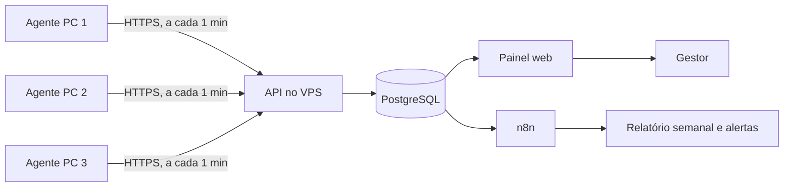

# Monitor Portoconseg — plano do sistema

Portoconseg · plano para aprovação · 06/11/2026 · versão visual: https://claude.ai/artifact/Bmr6nMr2u1vSY2kSqjq6aY

Sistema próprio para acompanhar o uso dos 3 computadores da corretora. Um programa leve roda em cada máquina, envia os dados para o VPS da Hostinger e o gestor vê tudo num painel web. Sem mensalidade.

> **Atualizado em 07/11/2026:** sem pergunta de justificativa e sem tela para o funcionário. Ele vê apenas o ícone do programa ao lado do relógio. Os relatórios aparecem só para o gestor. Objetivo: saber se o computador está em uso no horário combinado, para conhecimento próprio.
>
> **Decisões de 07/11/2026:** horário seg–qui 8h–18h, sex 8h–17h, sábado e domingo descanso. Inativo após 5 min sem teclado e mouse. Pendrive só registrado, sem bloqueio. Sistemas: sites diversos + SegFlex (instalado). Painel disponível a qualquer hora para André e Renata, com logins separados. E-mail toda segunda com o fechamento da semana. Prints periódicos sem desfoque e, sob demanda, print ou vídeo curto da tela pelo painel.

| Item | Valor |
|---|---|
| Máquinas | 3 — Windows 10 Home, Windows 11 Pro, Windows 11 Home |
| Servidor | VPS KVM 1 (ID 1340854), data center de Campinas/SP — dados ficam no Brasil |
| Licença | Zero. Custo é o VPS já contratado (renovação R$ 815,88/ano) |

## Alerta: Windows 10 Home sem atualizações de segurança

- Suporte do Windows 10 terminou em 14/10/2025.
- ESU doméstico terminou em 13/10/2026. A máquina não recebe correções.
- Máquina com dados de clientes. Ação: rodar "Verificação de Integridade do PC"; se compatível, atualizar para Windows 11; se não, planejar a troca.

## Fluxo

Classificação, verificada a cada 5 segundos, sem nenhuma pergunta ou aviso ao funcionário:

- **Ativo:** teclado ou mouse usados nos últimos 5 min → registra programa e domínio do site em uso.
- **Inativo:** 5 min ou mais sem teclado e mouse → registra só o horário.
- **Fora do computador:** tela bloqueada, PC suspenso ou desligado.

O limite de 5 min é configurável no painel.

Fila local no agente: sem internet, os dados ficam guardados e sobem quando a conexão volta.

## Entregas

1. **Base:** início automático com ícone visível; logon/logoff/bloqueio/suspensão; horários de atividade e inatividade, sem perguntas ao funcionário; programa em uso e domínio do site; jornada do dia; painel com linha do tempo e ranking de programas/sites; resumo do uso dentro do horário combinado (ativo, inativo, fora do computador).
   Inclui logins separados para André e Renata e programas instalados (ex.: SegFlex) no ranking.
2. **Tela:** print periódico sem desfoque, só no horário combinado e com o PC ativo; botão no painel para print imediato; botão para gravar vídeo curto (30–60 s, sem áudio); prints e vídeos na linha do tempo; exclusão automática após o prazo definido.
3. **Fechamento e controle:** e-mail toda segunda com o fechamento da semana anterior para André e Renata; pendrive só registrado (conexão e arquivos copiados); classificação de programas/sites e tempo por frente de trabalho; inventário e saúde do Windows; depois, se fizer sentido, integração Ploomes e Digisac.

Captura sob demanda: o painel grava um pedido; o agente consulta pedidos a cada poucos segundos, captura e envia. O vídeo é enviado como sequência de quadros (ex.: 2 por segundo) e montado em MP4 no servidor.

Estimativa de espaço (premissas, não medição): print de ~250 KB, 1 a cada 5 min, ~9 h ativas por dia, 3 máquinas, 5 dias → ~400 MB por semana; ~1,8 GB para 30 dias. Cabe com folga nos 50 GB do VPS.

## Recursos extras de produtividade

| Recurso | Avaliação |
|---|---|
| Tempo por frente de trabalho (cotação, atendimento, CRM, pós-venda, e-mail) | Recomendo |
| Comparação com a própria média do funcionário (sem ranking entre colegas) | Recomendo |
| Fechamento semanal por e-mail toda segunda (André e Renata) | Decidido |
| Uso no horário combinado: primeira/última atividade, tempo ativo, inativo e fora do PC (não substitui ponto oficial) | Núcleo |
| Blocos de foco e trocas de contexto por hora | Útil |
| Saúde das máquinas (disco, atualizações, antivírus) | Útil |
| Esforço x resultado com Ploomes | Depende de API — a confirmar |
| Atendimentos e tempo de resposta com Digisac | Depende de API — a confirmar |

**Fora de propósito:** keylogger, webcam/microfone, programa invisível, ranking público, título completo de janelas (pode conter dados de clientes; guarda-se só processo e domínio).

## Windows por máquina

| Máquina | Monitor | Bloqueio de USB | Atualizações |
|---|---|---|---|
| Windows 10 Home | Funciona | Registro (`USBSTOR\Start=4`) | Nenhuma desde 13/10/2026 |
| Windows 11 Pro | Funciona | Política de grupo | Em dia |
| Windows 11 Home | Funciona | Registro (`USBSTOR\Start=4`) | Em dia |

## Implantação

1. André: termo revisado por advogado e assinado pelos 3 funcionários.
2. André: ativar renovação automática do VPS (expira 06/02/2027).
3. André: criar `monitor.portoconseg.com.br` apontando para o VPS.
4. Claude: servidor, painel, agente Windows e instalador.
5. André: colar o script de instalação no terminal do VPS (hPanel).
6. André: instalar em 1 máquina e testar por 3 a 5 dias.
7. Claude: correções.
8. André: instalar nas outras 2 máquinas; seguir para a entrega 2.

## Tecnologia e segurança

- Agente e API em C# / .NET 10 (suporte até 14/11/2028; .NET 8 termina em 10/11/2026).
- PostgreSQL, Caddy com HTTPS automático, tudo em Docker Compose no VPS.
- Painel com login individual (André, Renata); chave por máquina; log de acesso; retenção de 90 dias (atividade) e prazo definido para prints e vídeos (sugestão 30 dias); backup diário.
- Prints e vídeos criptografados no VPS, visíveis só no painel. Sem áudio, sem webcam, sem registro de teclas.
- E-mail enviado por uma caixa da própria Hostinger (ex.: monitor@portoconseg.com.br). A senha fica só no VPS, nunca no código.
- Funcionário sem tela própria. Se pedir os próprios dados, o gestor exporta o relatório dele (direito de acesso, art. 18 da LGPD).
- Agente instalado em `Program Files` (gravação só por administrador) com exceção no Defender.

## Decisões pendentes

- Frequência dos prints periódicos (sugestão: 1 a cada 5 min, só ativo e no horário)
- Prazo para apagar prints e vídeos (sugestão: 30 dias)
- Ícone muda de cor durante gravação de vídeo (recomendado; sem janela nem pergunta)
- Intervalo de almoço (sugestão: sem prints periódicos nesse período)
- Lista de sites e sistemas por frente de trabalho (André vai enviar)

## Fontes

- Windows 10 fim de suporte: https://learn.microsoft.com/windows/release-health/release-information
- ESU Windows 10: https://learn.microsoft.com/windows/whats-new/extended-security-updates
- ESU doméstico até 13/10/2026: https://learn.microsoft.com/answers/a/12172995
- Suporte .NET: https://learn.microsoft.com/dotnet/core/releases-and-support
- Bloqueio de USB em edições Home: https://learn.microsoft.com/troubleshoot/windows-server/group-policy/removable-devices-group-policy-troubleshooting-guidance
- GetLastInputInfo: https://learn.microsoft.com/windows/win32/api/winuser/nf-winuser-getlastinputinfo
- Isolamento da sessão 0: https://learn.microsoft.com/windows/win32/services/service-changes-for-windows-vista
- Exceções no Defender: https://learn.microsoft.com/defender-endpoint/microsoft-defender-antivirus-exclusions-configure
- Limites do KVM 1: https://www.hostinger.com/support/6976044-parameters-and-limits-of-hosting-plans-in-hostinger/
- ANPD, Guia de Legítimo Interesse: https://www.gov.br/anpd/pt-br/centrais-de-conteudo/materiais-educativos-e-publicacoes/copy_of_guia_legitimo_interesse.pdf/@@display-file/file
